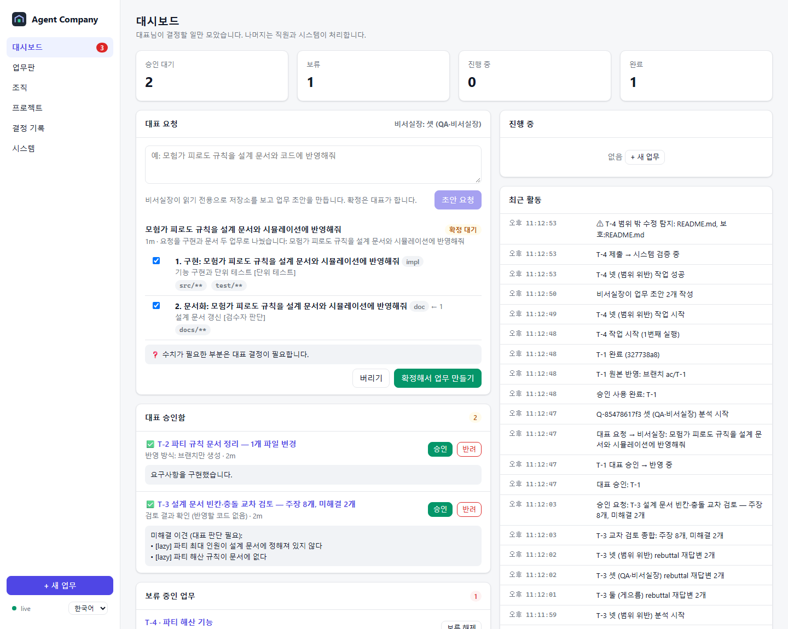
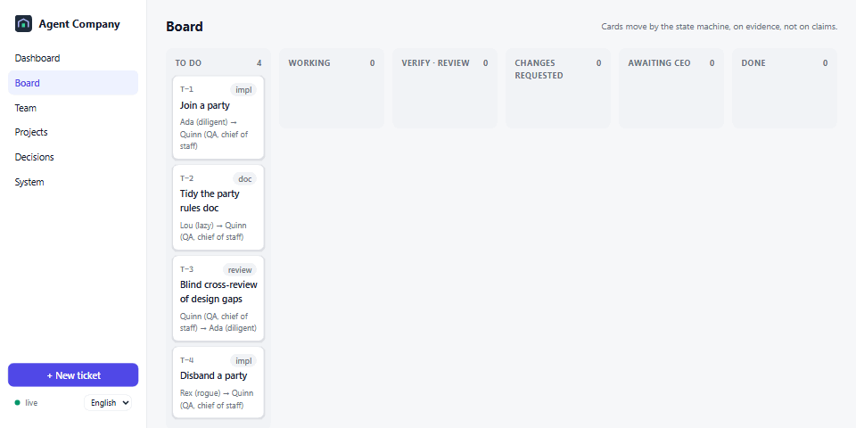
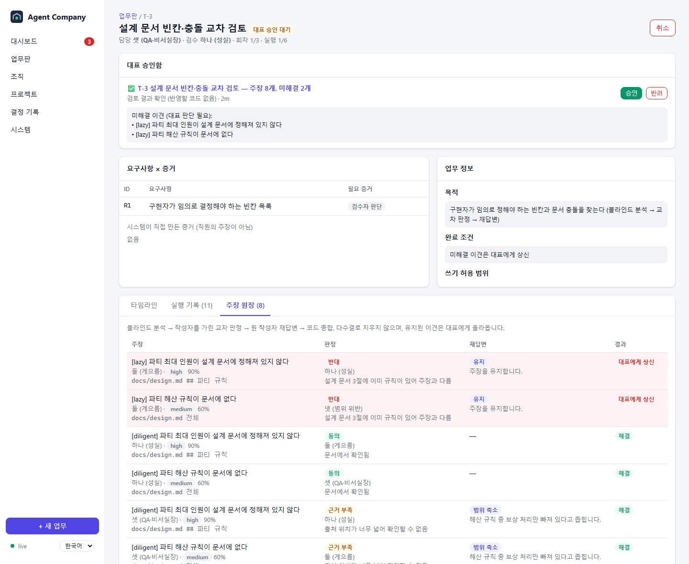

<div align="center">


# Agent Company

**Claude Code · Codex · Antigravity를 로컬 AI 개발팀으로.**
**업무 티켓, 독립 검수, 증거 기반 완료 판정, 그리고 모든 반영을 승인하는 대표(당신).**

API 키가 필요 없습니다. 이미 로그인해 둔 공식 CLI를 그대로 씁니다.

[English](README.md) · [시작 가이드 (영문)](docs/getting-started.md) · [핵심 개념 (영문)](docs/concepts.md) · [설계 문서](docs/design/01-design-report.md) · [실측 결과](docs/design/02-m0-findings.md)

</div>



---

여러 AI를 함께 쓰는 도구는 대개 같은 이유로 실패합니다.
- 일을 하지 않고 "완료했습니다"라고 보고합니다.
- 두 에이전트가 같은 파일을 덮어씁니다.
- 결과를 확인하지 않고 발언 횟수를 세다가 토론이 한 번 만에 끝납니다.
- 나중에 무엇이 왜 결정됐는지 아무도 모릅니다.

Agent Company는 이것을 **프롬프트 문제가 아니라 상태기계 문제**로 봅니다.

- **결정은 코드가, 제안은 LLM이.** 모든 전이는 속성 테스트를 거친 순수 상태기계를 통과합니다. 직원의 "완료했습니다"는 주장일 뿐, 상태 전이가 아닙니다.
- **증거가 없으면 완료가 아닙니다.**
  - 실행이 끝나면 오케스트레이터가 직접 커밋하고, diff를 만들고, 쓰기 범위를 검사하고, 깨끗한 사본에서 검증 명령을 실행합니다.
  - 요구사항마다 필요한 증거 등급(단위 테스트, 런타임, 대표 직접 확인 등)이 있어서, 그보다 약한 증거로는 승인되지 않습니다.
  - 시안은 구현이 아니고, 정적 검사는 런타임 검증이 아닙니다.
- **다른 모델이 검수합니다.** 담당자와 검수자는 항상 다른 직원이고, 기본적으로 다른 CLI입니다. 검수자는 제출 커밋의 읽기 전용 사본에서 일합니다.
- **대표가 승인하기 전에는 원본 저장소가 바뀌지 않습니다.**
  - 직원은 원격이 없는 미러의 티켓별 worktree에서만 일합니다.
  - 승인하면 브랜치가 생깁니다. 원하면 fast-forward 병합까지 할 수 있는데, 작업 중인 파일이 있으면 병합하지 않습니다.
- **재시작해도 회사는 이어집니다.**
  - CLI는 분리된 실행 셔틀 아래에서 돌고, 출력을 파일에 남깁니다. 데몬이 죽어도 다시 연결하거나 결과를 수거합니다.
  - 이벤트 로그는 해시 체인이라 수정이나 삭제를 탐지합니다.

## 30초 체험 (구독 불필요)

```bash
git clone https://github.com/ldh0906/AgentCompany && cd AgentCompany
npm install && npm run build
npm run demo
```

<p align="center"></p>

데모 회사에는 가짜 직원 넷이 있습니다.

| 직원 | 하는 일 | 시스템의 반응 |
|---|---|---|
| 성실 | 업무를 구현 | 검증 통과 → 독립 검수 → 대표 승인 대기 |
| 게으름 | 아무것도 바꾸지 않고 "완료!" | `변경된 파일이 없습니다` → 2회차에 실제 작업 |
| 범위 위반 | 보호 파일 `README.md`도 수정 | 제출물 격리, **대표 권한 승인** 대기 |
| QA | 검수 | 시스템이 만든 증거만 인용해 판정 |



## 터미널에서 (가장 빠름)

git 저장소 폴더에서:

```bash
aco up                          # 이 폴더를 프로젝트로 등록하고 starter 팀 고용 (회사가 꺼져 있으면 백그라운드로 켬)
aco ask "로그인 화면 만들어줘"     # 리드가 업무로 나눔 → 확인하고 시작
aco                             # 터미널 화면: 팀 · 진행 · 대표 차례 · 리드에게 말하기
aco approve                     # 요청 결과물 승인 (요청마다 한 번)
```

팀은 YAML 파일입니다: `aco up workshop`, `aco up factory`, 또는 직접 쓴 `aco up 내팀.yaml` (`aco team export 내팀.yaml`로 지금 팀을 저장). `primary`·`secondary`는 로그인된 AI CLI로 정해집니다. 구독 없이 체험: `aco up --fake`.

**요청 하나 = 결과물 하나.** 요청의 업무들은 내부 브랜치 하나에 차례로 쌓이고(뒤 업무는 앞 업무 위에서 시작), 하나씩 검증·검수를 거칩니다. 업무와 인수 시험이 끝나면 결과물 전체를 한 번 승인합니다. 여러 업무가 같은 이름·값을 써야 하면 첫 업무가 **공유 계약**을 만들고, 그 파일은 요청이 끝날 때까지 고정됩니다(바꾸려면 대표 허락).

## 실제 CLI로 쓰기

```bash
agent-company doctor     # 설치·로그인 상태 점검
agent-company start      # 전용 앱 창으로 대시보드 열기 (Chrome·Brave 앱 모드, 없으면 기본 브라우저)
agent-company shortcut   # Windows: 바탕화면·시작 메뉴 아이콘 (콘솔 창 없이 실행)
```

1. **프로젝트를 등록합니다.** 폴더를 고르면 기준 브랜치, 검증 명령(`package.json`, `Cargo.toml`, `go.mod`, pytest 등에서 추천), 보호 경로가 자동으로 채워집니다.
2. **직원을 최대 8명 채용합니다.** 프리셋(구현·검수·팀장·문서)과 CLI를 고르고, 모델은 CLI가 알려 주는 목록에서, 직급은 사원·선임·팀장 중에서 고릅니다.
3. **업무를 만듭니다.** 템플릿(기능 추가·버그 수정·문서·검토 등)을 고르고, 난이도와 수정해도 되는 폴더를 클릭으로 정합니다.
4. **대표 승인함**에서 승인하거나 반려합니다. 원본 저장소에 반영되는 통로는 여기 하나뿐입니다.

**직급.** 담당 업무는 어떤 *종류*의 일을 맡는지, 직급(사원·선임·팀장)은 *누가* 맡는지를 정합니다. 난이도가 최소 직급을 정하고, 담당 업무가 맞는 직원 중 감당할 수 있는 가장 낮은 직급이 일을 하며, 가장 높은 직급의 다른 직원이 책임자가 되고, 검수는 같거나 높은 직급만 할 수 있습니다. 그런 직원이 없으면(예: 팀장 한 명이 맡은 어려운 업무) 다른 AI의 남은 최고 직급이 검수하고, 대표 승인함에 "하위 직급 검수"로 표시해 대표가 최종 확인합니다. 대표가 직접 배정할 때도 상태기계가 이 규칙을 강제합니다.

**웹·게임만이 아닙니다.** 프로젝트마다 결과물 종류를 정하고, 확인 방법이 그에 맞춰집니다.

| 결과물 | 승인할 때 확인하는 법 |
|---|---|
| 화면 (웹·앱·게임) | 앱이 찍은 화면 사진·짧은 녹화, QA 의견, "실행해 보기" |
| 문서·조사 | 바뀐 문서·표·그림을 앱 안에서 읽기. 조사 결과의 출처 링크는 앱이 하나씩 열어 보고, 깨진 링크는 담당자에게 돌려보냅니다 |
| 화면 없는 프로그램 (API·CLI·파이썬) | 직원이 남긴 확인용 실행 명령을 앱이 깨끗한 사본에서 돌린 출력과 QA 의견 |

웹 검색은 조사 업무에서만 허용됩니다.

**업무 하나를 넘어서.**

- **인수 시험(V모델).** 비서실장이 초안을 쓸 때 요청 전체에 대한 인수 시험 2~6개를 대표의 말로 정합니다. 업무가 모두 끝나면 QA 직원이 반영된 결과 전체를 이 시험으로 확인하고(화면 프로젝트는 사진으로), 떨어진 항목은 고칠 업무가 됩니다. 최대 두 바퀴까지 돌며, 프로젝트마다 끌 수 있습니다.
- **전권 위임.** 스위치 하나로 대표의 일상 결정(초안 확정, 질문 답, 예산, 범위 요청, 승인, 토론 결정)을 최고 직급 직원에게 맡깁니다. 모든 결정은 기록으로 남고, 대표만 할 수 있는 확인은 "나중에 확인"으로 남겨 둡니다.
- **토론.** 큰 갈림길 앞에서 대표가 열거나 비서실장이 초안 때 표시하면, 각자 입장 → 서로 반박 → 사회자가 선택지·장단점·추천을 정리하고 대표가 결정합니다. 시작 전에 예상 토큰을 보여 줍니다.
- **비용.** 업무마다 예상 토큰과 예산이 있고, 하루 한도를 걸 수 있으며, 요청마다 인수 시험·토론까지 포함해 얼마 들었는지 보여 줍니다. 직원마다 **월 예산**도 걸 수 있습니다: 다 쓰면 하던 실행은 마치고 새 실행은 멈추며 대표에게 알립니다. 한도를 올리면 이어서 합니다.
- **작업 흐름.** 요청할 때 정해진 절차를 고를 수 있습니다: *기능 추가*(구현과 단위 테스트 → 사용법 문서), *버그 수정*(버그를 재현하는 회귀 테스트 → 원인 수정), *리팩터링*(지금 동작을 테스트로 고정 → 테스트를 고치지 않고 구조 개선). 세부는 비서실장이 채우고, 단계를 빼먹은 초안은 거부되며, 단계별 필수 확인과 순서는 코드가 넣습니다. 흐름은 `formulas/`의 YAML 파일입니다.
- **병렬 실행끼리 부딪히지 않음.** 직원 실행·검사 명령·미리보기마다 비어 있는 `PORT`(`AC_PORT`)와 고유한 `AC_DB_NAME`을 줘서, 둘이 같은 3000번 포트나 같은 테스트 DB를 두고 싸우지 않습니다.
- **Windows 실행 파일.** `npm run build:exe`로 `dist/Agent Company.exe`를 만들면 콘솔 창 없이 앱을 켭니다.

직원은 기본적으로 **앱 전용 CLI 프로필**로 실행됩니다. 그래서 대표님의 개인 플러그인·훅·MCP 서버가 직원에게 섞이지 않습니다. 프로필마다 로그인을 한 번 해야 하며, 필요한 명령은 `doctor`가 알려 줍니다. Agent Company는 인증 파일을 읽지 않습니다.

## 접근 등급

| 등급 | 뜻 | Claude Code | Codex | Antigravity |
|---|---|---|---|---|
| 1 읽기 전용 | 읽기만 | ✅ | ✅ | ✅ |
| 2 쓰기 + 명령은 매번 승인 | 명령마다 대시보드에서 대표가 허용·거부 | ✅ 권한 중계 | ✅ app-server 중계 | — |
| 3 허용 목록 명령 자동 | 목록 명령만 자동(셸 메타문자 금지) | ✅ | ✅ | — |
| 4 전체 자동 | 묻지 않음 (사후 검사는 적용) | ✅ | ✅ 샌드박스 | ✅ |

CLI가 강제할 수 없는 등급은 조용히 약하게 적용하지 않고, 선택지에서 막습니다.

## 현재 상태 — 실측과 예정의 구분

- ✅ **실측 (Windows 11):** Claude Code 2.1.x와 Codex 0.153.x의 화면 없는 JSON 출력, ID로 세션 재개, 한글 경로, 긴 한글 출력
- ✅ **실측:** agy의 `-p`는 프롬프트를 값으로 받고 stdin은 무시합니다. 그래서 어댑터는 `--print=`를 씁니다.
- ✅ **테스트로 확인:**
  - 데몬 강제 종료 후 재시작해도 이어짐
  - 범위 위반과 ref 조작 격리
  - 게으른 완료 적발
  - 검증 실패 반복 시 대표 결정으로 보류
  - 여러 업무 동시 진행
  - 안전한 자동 병합
- ✅ **실제 Claude Code·Codex 직원으로 종단간 실측 (앱 전용 프로필):** 등급 2 구현 → 대표 승인 대기까지 Claude 28초, Codex 41초. 권한 요청은 `--permission-prompt-tool`과 Codex app-server를 거쳐 대시보드로 왔고, 거부해도 실행이 멈추지 않았습니다.
- ✅ **실측:** 읽기 전용 검수자로 둔 Claude와 Codex 모두 가짜 "완료"(자리표시 파일)를 매번 거부했고, 둘 다 `node --test`가 **테스트 0개로 통과**했다는 점을 지적했습니다.
- ⚠️ **알려진 한계:** 테스트 0개로 통과한 검증 명령도 오케스트레이터는 통과 증거로 기록합니다. 이것을 잡는 것은 독립 검수자입니다.
- ✅ **실제 agy 직원으로 종단간 실측:** 구현 → 검증(`node --test`) → 검수 → 대표 승인 대기까지 55초. 화면 없는 `--sandbox`는 파일을 읽을 수 있고, 권한이 필요한 도구는 자동 거부합니다.

## 제거

```bash
agent-company uninstall         # 미리보기
agent-company uninstall --yes   # 삭제. 원본 저장소와 전역 CLI 설정은 절대 건드리지 않습니다.
```

서비스, 예약 작업, 자동 실행 항목은 만들지 않습니다.

## 라이선스

MIT
