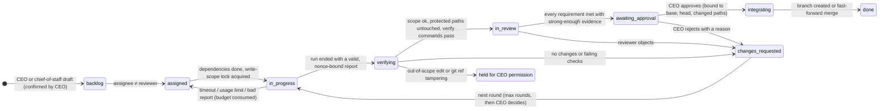

<div align="center">


# Agent Company

**Run Claude Code, Codex and Antigravity as a local AI dev team — with tickets, independent review, evidence-gated completion and a human CEO who approves every merge.**

No API keys. It drives the official CLIs you are already logged into.

[한국어](README.ko.md) · [Design](docs/design/01-design-report.md) · [Measured CLI facts](docs/design/02-m0-findings.md)

</div>

---

Multi-agent tools usually fail in the same ways: agents say "done" without doing the work, two agents overwrite the same file, a debate ends after one round because someone counted messages instead of checking results, and nobody can tell afterwards what was decided or why.

Agent Company treats this as a **state machine problem, not a prompting problem**:

- **Code decides, LLMs propose.** Every ticket transition goes through a pure, property-tested state machine. An employee's "I'm done" is a claim, never a transition.
- **Evidence or it didn't happen.** After each run the orchestrator itself commits the worktree, computes the diff, checks the write scope, and runs your verify commands in a clean checkout. Requirements declare the evidence they need (`unit_test`, `runtime`, `human_attest`…) and a reviewer cannot approve with weaker evidence. A mockup is not an implementation.
- **Different model reviews.** Assignee and reviewer are always different employees (by default different CLIs). The reviewer works on a read-only copy of the submitted commit.
- **Your repo is untouched until you approve.** Employees work in per-ticket worktrees of a remote-less bare mirror. After your approval you get a branch — or, if you choose, a fast-forward-only merge that refuses to touch a dirty working tree.
- **The company survives restarts.** CLIs run under a detached shim, write output to files, and the daemon re-attaches (or collects the result) after a crash. The event log is hash-chained, so edits and deletions are detected.

## Try it in 30 seconds (no subscription needed)

```bash
git clone https://github.com/<you>/agent-company && cd agent-company
npm install && npm run build
npm run demo
```

The demo company has four fake employees: a diligent one, a **lazy** one who claims "done" without changing anything, a **rogue** one who edits a protected file, and a QA reviewer. Watch the system catch both:

| Employee | What they do | What the system does |
|---|---|---|
| diligent | implements the ticket | verify commands pass → independent review → waits for your approval |
| lazy | says "All done!" with no changes | `verification_failed: no files changed` → round 2 → real work |
| rogue | also edits `README.md` (protected) | submission quarantined, ticket held for **your** permission |

## Use it with your real CLIs

```bash
npx agent-company doctor     # which CLIs are installed and logged in
npx agent-company start      # opens the dashboard at http://127.0.0.1:4777
```

1. **Register a project**: path to a git repo, base branch, verify commands (`npm test`, `dotnet test`…), protected paths.
2. **Hire up to 4 employees**: pick the CLI, the model and an access level.
3. **Create a ticket** with requirements and the minimum evidence for each.
4. Approve or reject in the **CEO inbox**. That's the only place work reaches your repo.

By default employees run in **app-only CLI profiles** (`CLAUDE_CONFIG_DIR`, `CODEX_HOME`) so your personal plugins, hooks and MCP servers do not leak into employee runs. Log in once per profile — `doctor` prints the exact command. Agent Company never reads credential files.

## Access levels

| Level | Meaning | Claude Code | Codex | Antigravity |
|---|---|---|---|---|
| 1 Read only | read files | ✅ | ✅ `-s read-only` | ✅ `--sandbox` |
| 2 Write, ask for commands | edits allowed, each command asks **you** in the dashboard | ✅ `--permission-prompt-tool` relay | ✅ app-server relay | — |
| 3 Allowlisted commands | your allowlist runs (no shell metacharacters), others ask | ✅ | ✅ | — |
| 4 Full auto | nothing asks (post-run checks still apply) | ✅ | ✅ workspace-write sandbox | ✅ |

Levels a CLI cannot enforce are greyed out instead of silently degraded.

## Status — what is measured vs. planned

This project separates **measured facts** from assumptions ([details](docs/design/02-m0-findings.md)).

- ✅ Measured on Windows 11: headless JSON, session resume by ID, Korean paths and long Korean output for Claude Code 2.1.x and Codex 0.153.x.
- ✅ Measured: Antigravity `agy -p` takes the prompt as a value and ignores stdin (the adapter uses `--print=`).
- ✅ Tested: crash/restart continuity with a real daemon kill, scope violations, ref tampering, lazy completion, verify-failure budgets, concurrent tickets, auto-merge safety.
- ⏳ Not yet measured end-to-end with real subscriptions: Claude `--permission-prompt-tool` relay, Codex app-server approvals, Antigravity permission behavior in headless mode.

## How a ticket moves

Every arrow is a guarded transition in `src/core/ticket-machine.ts`. LLM output never moves a card by itself.



Review tickets use a different path: blind analysis → anonymized cross-verdicts → mandatory author rebuttal → deterministic synthesis. Disputes the author keeps are escalated to you, never outvoted.

## Architecture

```
Browser (React, ko/en) ──REST + SSE (127.0.0.1, token, Host/Origin checks)──┐
                                                                            │
  company daemon (Node, single process)                                     │
  ├─ core/ticket-machine   pure state machine (who may do what, when)       │
  ├─ app/orchestrator      assign · run · verify · review · approve · merge │
  ├─ runner/shim           detached shim → CLI with hidden console          │
  ├─ adapters/             claude · codex · agy · fake                      │
  ├─ workspace/            bare mirror · worktrees · scope · integration    │
  └─ store/                SQLite (node:sqlite) + hash-chained events       │
```

Zero runtime dependencies. Node ≥ 22.18. Windows first, macOS/Linux supported.

## Security model (short)

- Messages between employees are data records, never terminal input. Nothing is ever run through a shell.
- Approvals are single-use and bound to the exact submission (`base`, `head`, changed paths). If the branch moves after you approve, the approval is void.
- Same-user processes are outside any real security boundary; enforcement is layered (CLI permissions → post-run scope/ref/protected-path checks → quarantine). See [SECURITY.md](SECURITY.md).

## Uninstall

```bash
npx agent-company uninstall         # preview: data dir, size, dirty worktrees
npx agent-company uninstall --yes   # delete. Your repos and global CLI configs are never touched.
```

No services, scheduled tasks or autostart entries are ever created.

## Development

```bash
npm test          # 65 tests: state machine properties, git workspace, e2e with fake agents, crash/restart
npm run typecheck
npm run dev       # demo daemon from source
npm run dev:web   # Vite dev server for the dashboard (proxy to :4777)
```

## License

MIT
