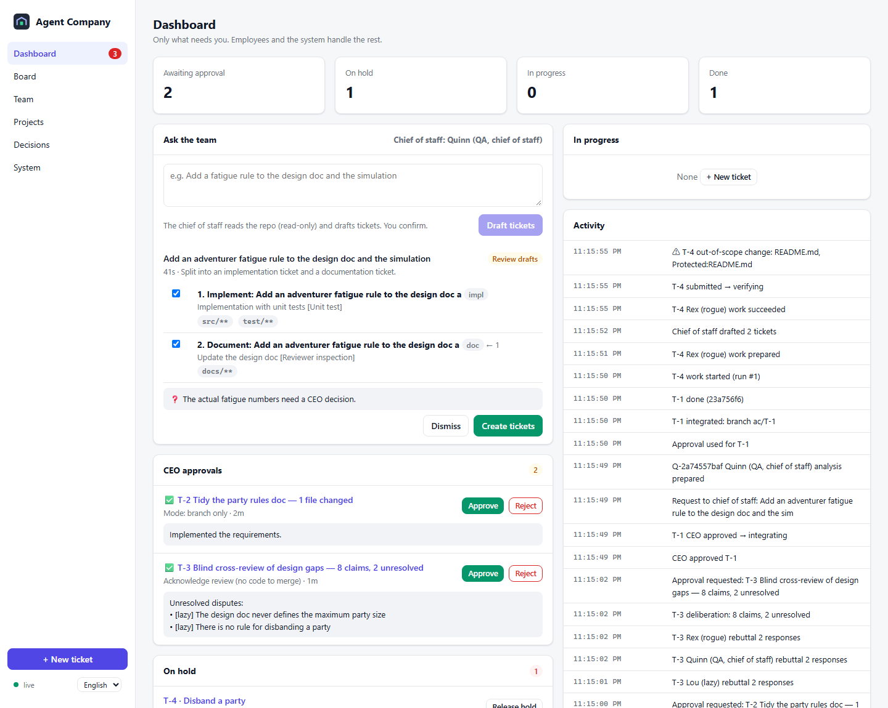
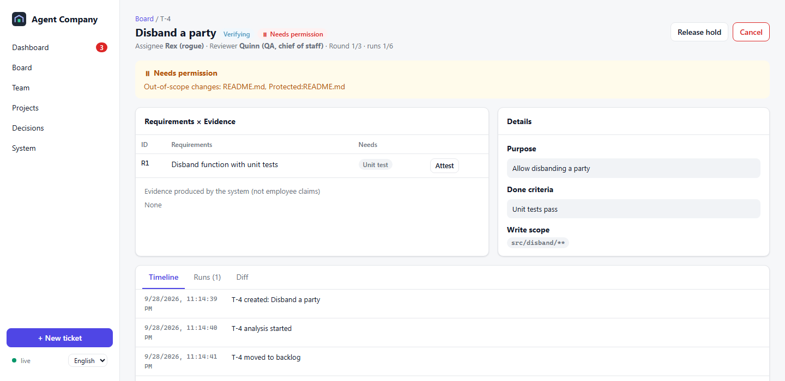
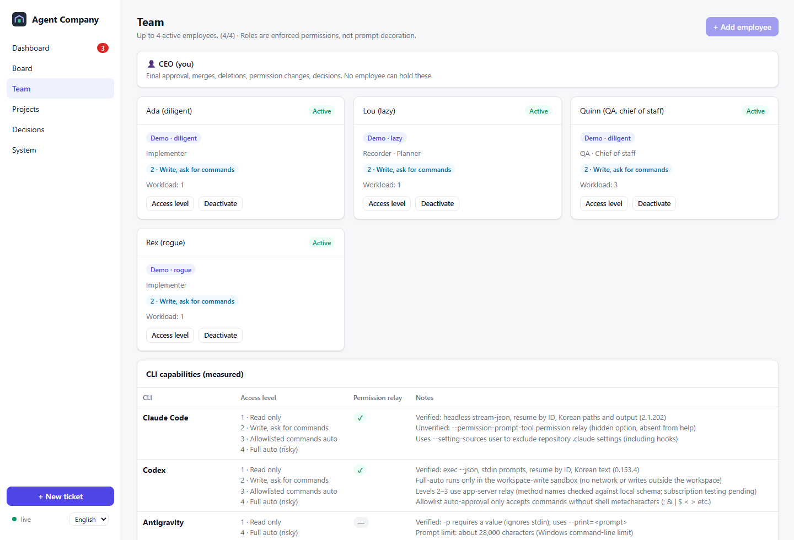
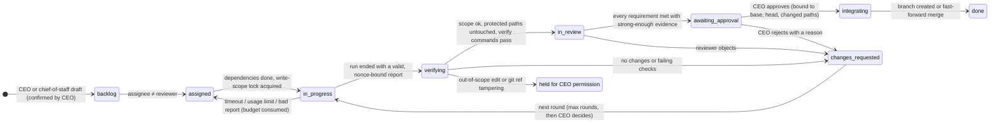
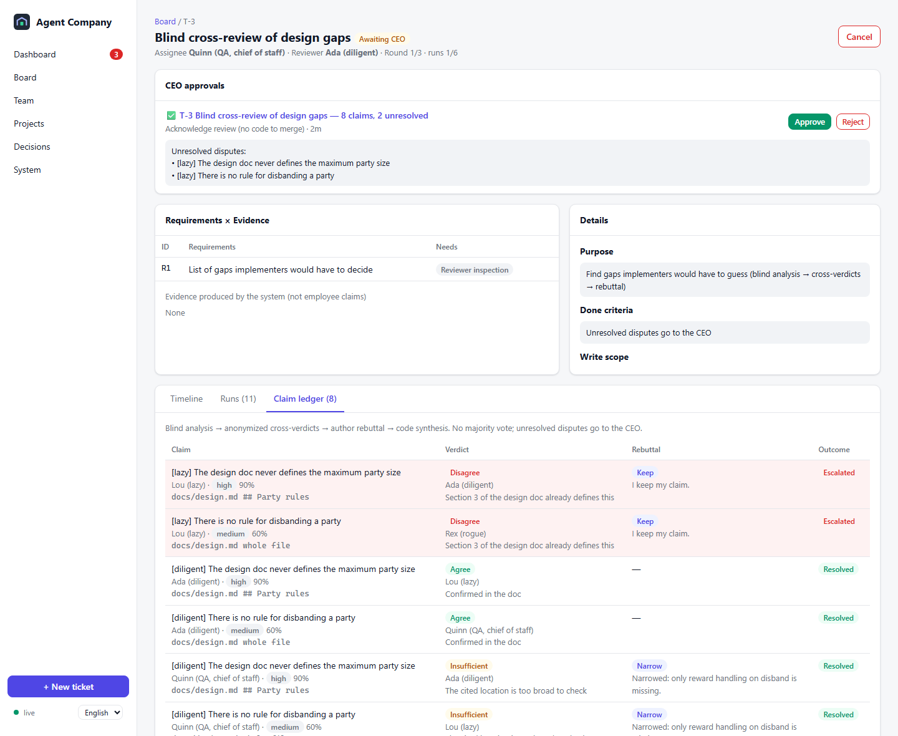

<div align="center">


# Agent Company

**Run Claude Code, Codex and Antigravity as a local AI dev team — with tickets, independent review, evidence-gated completion and a human CEO who approves every merge.**

No API keys. It drives the official CLIs you are already logged into.

[한국어](README.ko.md) · [Getting started](docs/getting-started.md) · [Concepts](docs/concepts.md) · [Design](docs/design/01-design-report.md) · [Measured CLI facts](docs/design/02-m0-findings.md)

</div>



---

Multi-agent tools usually fail in the same ways: agents say "done" without doing the work, two agents overwrite the same file, a debate ends after one round because someone counted messages instead of checking results, and nobody can tell afterwards what was decided or why.

Agent Company treats this as a **state machine problem, not a prompting problem**:

- **Code decides, LLMs propose.** Every ticket transition goes through a pure, property-tested state machine. An employee's "I'm done" is a claim, never a transition.
- **Evidence or it didn't happen.** After each run the orchestrator itself commits the worktree, computes the diff, checks the write scope, and runs your verify commands in a clean checkout. Requirements declare the evidence they need (`unit_test`, `runtime`, `human_attest`…) and a reviewer cannot approve with weaker evidence. A mockup is not an implementation.
- **Different model reviews.** Assignee and reviewer are always different employees (by default different CLIs). The reviewer works on a read-only copy of the submitted commit.
- **Your repo is untouched until you approve.** Employees work in per-ticket worktrees of a remote-less bare mirror. After your approval you get a branch — or, if you choose, a fast-forward-only merge that refuses to touch a dirty working tree.
- **The company survives restarts.** CLIs run under a detached shim, write output to files, and the daemon re-attaches (or collects the result) after a crash. The event log is hash-chained, so edits and deletions are detected.

## Try it in 30 seconds (no subscription needed)

```bash
git clone https://github.com/ldh0906/AgentCompany && cd AgentCompany
npm install && npm run build
npm run demo
```

<p align="center"></p>

The demo company has four fake employees: a diligent one, a **lazy** one who claims "done" without changing anything, a **rogue** one who edits a protected file, and a QA reviewer. Watch the system catch both:

| Employee | What they do | What the system does |
|---|---|---|
| diligent | implements the ticket | verify commands pass → independent review → waits for your approval |
| lazy | says "All done!" with no changes | `verification_failed: no files changed` → round 2 → real work |
| rogue | also edits `README.md` (protected) | submission quarantined, ticket held for **your** permission |

<p align="center"></p>

## From the terminal (fastest)

Run these inside a git repository:

```bash
aco up                         # register this folder, hire the starter team (starts the company in the background)
aco ask "add a login screen"   # the lead splits it into tickets → you confirm → work starts
aco                            # terminal screen: team, progress, what needs you, talk to the lead
aco approve                    # approve the request's result (one approval per request)
```

Teams are YAML files: `aco up workshop`, `aco up factory`, or your own `aco up my-team.yaml` (`aco team export my-team.yaml` saves the current one). `primary`/`secondary` pick whichever AI CLIs you are logged into. No subscription? `aco up --fake`.

**One request, one result.** The tickets of a request stack on one internal branch (later tickets build on earlier ones), each verified and reviewed on the way. When they and the acceptance test are done you approve the whole result once. If several tickets must agree on names or values, the first ticket is a **shared contract**: its files are frozen for the rest of the request, and only you can allow a change.

## Use it with your real CLIs

```bash
agent-company doctor     # which CLIs are installed and logged in
agent-company start      # opens the dashboard in its own app window (Chrome/Brave app mode, else your default browser)
agent-company shortcut   # Windows: desktop + Start menu icon that starts it without a console
```

1. **Register a project**: browse to a git repo; the base branch, verify commands (from `package.json`, `Cargo.toml`, `go.mod`, pytest…) and protected paths are filled in for you.
2. **Hire up to 8 employees**: pick a preset (implementer, QA, lead, docs), the CLI, a model from the CLI's own list, and a **rank**.
3. **Create a ticket** from a template (feature, bug fix, docs, review…), pick the difficulty and click the folders it may change.
4. Approve or reject in the **CEO inbox**. That's the only place work reaches your repo.

**Ranks.** Duties decide *what kind* of work an employee takes; ranks (junior · senior · lead) decide *who* takes it. A ticket's difficulty sets the minimum rank, the duty-fit employee of the lowest adequate rank does the work, the highest-ranked other employee owns it, and the reviewer must be the same rank or higher. When nobody qualifies (say, the only lead does a hard ticket), the highest remaining rank on a different CLI reviews it and the CEO inbox flags it as a lower-rank review. The state machine enforces this for your manual assignments too.

**Not only web pages and games.** Each project says what it produces, and checking follows it:

| Project produces | How you check it at approval |
|---|---|
| Screens (web, app, game) | screenshots and short recordings taken by the app, QA notes, "Run it" |
| Documents and research | the changed Markdown, tables and pictures rendered in the app; every source link in research is opened by the app, and broken ones go back to the employee |
| Programs without a screen (API, CLI, Python) | the output of demo commands the employee leaves, run by the app on a clean copy and read by a QA colleague |

Research tickets may use web search; other tickets cannot.

**Beyond single tickets.**

- **Acceptance tests (V-model).** When drafting, the chief of staff writes 2–6 acceptance tests for the whole request in the CEO's words. When every ticket is done, a QA employee checks the merged result against them (with screenshots for screen projects) and failed items become fix tickets, for at most two rounds. It can be switched off per project.
- **Full delegation.** One switch hands the CEO's routine decisions (confirming drafts, answering questions, budgets, scope requests, approvals, debates) to the top-ranked employee. Every decision is logged, and checks only the CEO can do are kept as "check later".
- **Debates.** Before a big fork, the CEO (or the chief of staff, while drafting) opens a debate: positions, rebuttals, then a moderator summary with options and a recommendation for the CEO to decide. The app shows the estimated token cost first.
- **Costs.** Each ticket has a token estimate and budget, there is an optional daily limit, and every request shows what it cost, including acceptance tests and debates.
- **Windows launcher.** `npm run build:exe` builds `dist/Agent Company.exe`, which starts the app without a console window.

By default employees run in **app-only CLI profiles** (`CLAUDE_CONFIG_DIR`, `CODEX_HOME`) so your personal plugins, hooks and MCP servers do not leak into employee runs. Log in once per profile — `doctor` prints the exact command. Agent Company never reads credential files.

## Access levels

| Level | Meaning | Claude Code | Codex | Antigravity |
|---|---|---|---|---|
| 1 Read only | read files | ✅ | ✅ `-s read-only` | ✅ `--sandbox` |
| 2 Write, ask for commands | edits allowed, each command asks **you** in the dashboard | ✅ `--permission-prompt-tool` relay | ✅ app-server relay | — |
| 3 Allowlisted commands | your allowlist runs (no shell metacharacters), others ask | ✅ | ✅ | — |
| 4 Full auto | nothing asks (post-run checks still apply) | ✅ | ✅ workspace-write sandbox | ✅ |

Levels a CLI cannot enforce are greyed out instead of silently degraded.

<p align="center"></p>

## Status — what is measured vs. planned

This project separates **measured facts** from assumptions ([details](docs/design/02-m0-findings.md)).

- ✅ Measured on Windows 11: headless JSON, session resume by ID, Korean paths and long Korean output for Claude Code 2.1.x and Codex 0.153.x.
- ✅ Measured: Antigravity `agy -p` takes the prompt as a value and ignores stdin (the adapter uses `--print=`).
- ✅ Tested: crash/restart continuity with a real daemon kill, scope violations, ref tampering, lazy completion, verify-failure budgets, concurrent tickets, auto-merge safety.
- ✅ Measured end-to-end with a real Antigravity employee: implement → verify (`node --test`) → review → awaiting CEO in 55 s. Headless `--sandbox` can read files, and tools that need permission are auto-denied.
- ✅ Measured end-to-end with real Claude Code and Codex employees on app-only profiles: implement at level 2 → awaiting CEO in 28 s (Claude) and 41 s (Codex). Their permission requests reached the dashboard through `--permission-prompt-tool` and the Codex app-server; a denied request did not stop the run.
- ✅ Measured: as read-only reviewers, Claude and Codex both rejected a fake "done" (a placeholder file) every round, and both called out that `node --test` had passed with **zero tests**.
- ⚠️ Known limit: the orchestrator records a verify command that passes with zero tests as passing evidence; the independent reviewer is what catches it.

## Built the way it tells you to build

Every change in this repository was reviewed by a different model (Codex, read-only), and every objection had to be answered with a fix **and** a regression test. Eleven review rounds found 35 P1 defects the tests had missed before the reviewer approved: among them a way for verify commands to modify your repository before approval, a time-of-check/time-of-use bug in integration, and a prompt-injection path that let an employee review its own claim. The full log: [docs/design/03-review-log.md](docs/design/03-review-log.md).

## How a ticket moves

Every arrow is a guarded transition in `src/core/ticket-machine.ts`. LLM output never moves a card by itself.



Review tickets use a different path: blind analysis → anonymized cross-verdicts → mandatory author rebuttal → deterministic synthesis. Disputes the author keeps are escalated to you, never outvoted.



## Architecture

```
Browser (React, ko/en) ──REST + SSE (127.0.0.1, token, Host/Origin checks)──┐
                                                                            │
  company daemon (Node, single process)                                     │
  ├─ core/ticket-machine   pure state machine (who may do what, when)       │
  ├─ app/orchestrator      assign · run · verify · review · approve · merge │
  ├─ runner/shim           detached shim → CLI with hidden console          │
  ├─ adapters/             claude · codex · agy · fake                      │
  ├─ workspace/            bare mirror · worktrees · scope · integration    │
  └─ store/                SQLite (node:sqlite) + hash-chained events       │
```

Zero runtime dependencies. Node ≥ 22.18. Windows first, macOS/Linux supported.

## Security model (short)

- Messages between employees are data records, never terminal input. Nothing is ever run through a shell.
- Approvals are single-use and bound to the exact submission (`base`, `head`, changed paths). If the branch moves after you approve, the approval is void.
- Same-user processes are outside any real security boundary; enforcement is layered (CLI permissions → post-run scope/ref/protected-path checks → quarantine). See [SECURITY.md](SECURITY.md).

## Uninstall

```bash
agent-company uninstall         # preview: data dir, size, dirty worktrees
agent-company uninstall --yes   # delete. Your repos and global CLI configs are never touched.
```

No services, scheduled tasks or autostart entries are ever created.

## Development

```bash
npm test          # ~270 tests: unit (4 at a time, ~1 min) then e2e with fake agents (2 at a time, ~25 min)
npm run test:unit # unit tests only
npm run typecheck
npm run build:exe # after npm run build: dist/Agent Company.exe (Windows launcher, needs Node.js)
npm run dev       # demo daemon from source
npm run dev:web   # Vite dev server for the dashboard (proxy to :4777)
```

## License

MIT
